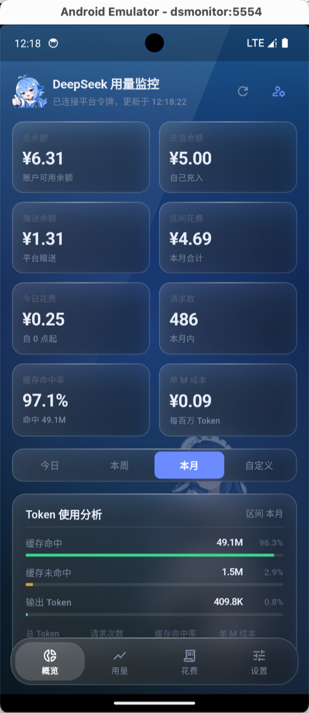
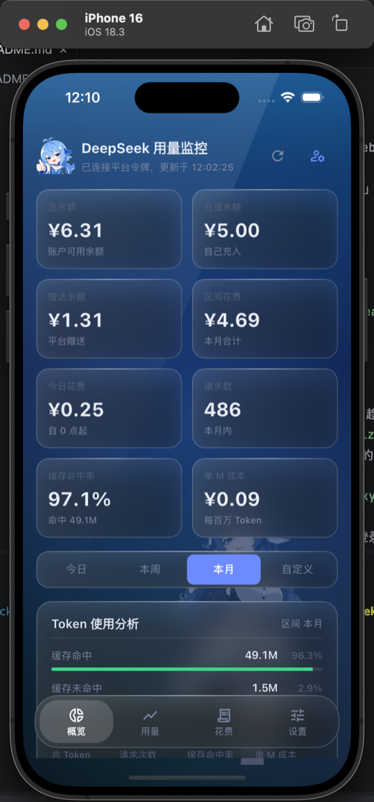
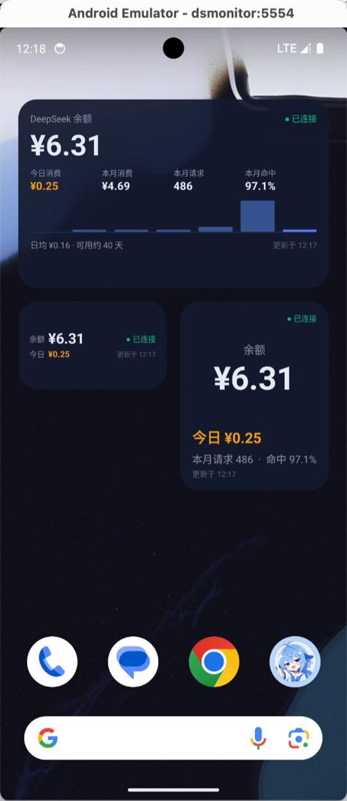
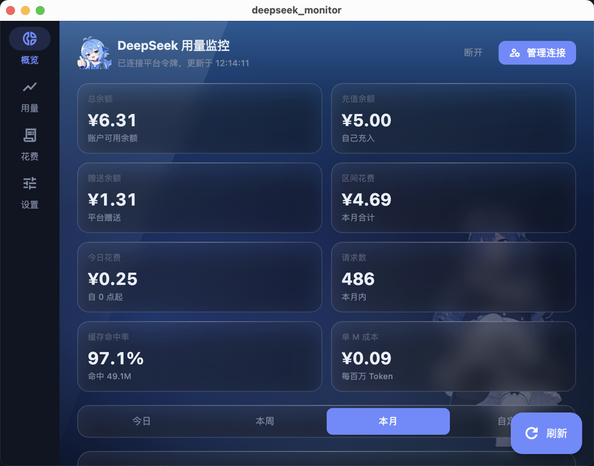
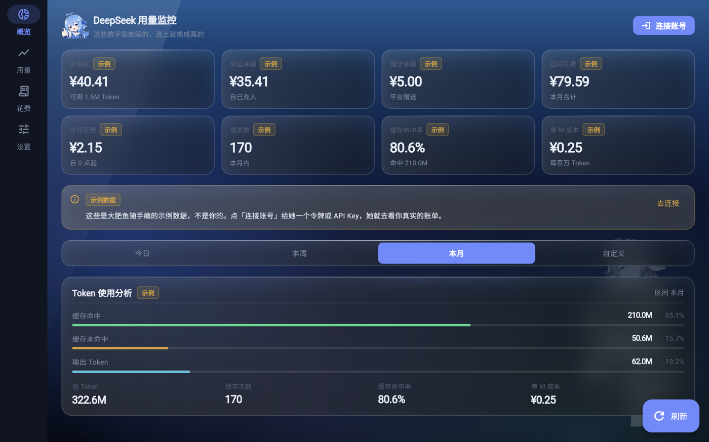

<div align="center">


# DeepSeek Monitor

**DeepSeek 余额与用量的跨平台监控面板**

一套 Flutter 代码，六个平台：Android · iOS · macOS · Windows · Linux · Web

[](LICENSE)
[](https://flutter.dev)
[](#开发)
[](#开发)
[](#平台支持)

[在线体验](https://lucky845.github.io/deepseek-monitor/) · [功能](#功能) · [截图](#截图) · [快速开始](#快速开始) · [文档](#文档)

</div>

---

打开就能看：默认进入仪表盘并展示**示例数据**，不登录也能体验全部界面。点右上角「连接账号」接上自己的账户，数字才会变成真的——并且每一块数据都会标明自己是真的还是示例的。

---

## 截图

<table>
<tr>
<td align="center" width="33%"><br><sub><b>Android</b> · 已连接</sub></td>
<td align="center" width="33%"><br><sub><b>iOS</b> · 已连接</sub></td>
<td align="center" width="33%"><br><sub><b>Android</b> · 桌面小组件</sub></td>
</tr>
<tr>
<td align="center" colspan="3"><br><sub><b>macOS</b> · 宽屏把四块内容排成一页</sub></td>
</tr>
<tr>
<td align="center" colspan="3"><br><sub><b>Web</b> · 浏览器里的同一个仪表盘</sub></td>
</tr>
</table>

未连接状态、小组件三个尺寸等更多截图见 [`docs/screenshots/`](docs/screenshots/)。

## 功能

**看得懂钱花在哪**

- 区间筛选联动全部数据：今日 / 本周 / 本月 / 自定义日期
- KPI 八格：总余额、充值余额、赠送余额、区间花费、今日花费、请求数、缓存命中率、单 M 成本
- Token 分析：缓存命中 / 未命中 / 输出 三者的构成与占比，配合请求次数
- 趋势图：一天以内按小时桶（`HH:00`），多天按日桶（`MM/dd`），可切 Token / 请求 / 金额三个镜头
- 模型明细：按模型拆出 Token、请求、费用、每 M Token 单价与占比
- API Key 对比：多个 Key 各自的花费、Token、请求次数与主力模型横向排名

**不像监控工具的监控工具**

- 玻璃拟态（glassmorphism）界面，透明度可调并跨次启动记住
- 响应式：手机上一屏一块内容 + 底部 tab，宽屏自动铺成一页
- 深浅两套配色围绕同一套语义色，不靠滤镜

**不假装自己知道**

- 余额没取到就渲染 `—`，不填示例数字
- 只连了 API Key 时，余额是真的、用量明确标注「示例」
- 跨域被拦时告诉你「浏览器拦下了跨域请求」和一条反代出路，而不是丢一个 `Failed to fetch`

**桌面小组件**

- Android：2×1 / 2×2 / 4×2 三个尺寸，WorkManager 后台每 30 分钟自动刷新，不用打开应用
- iOS / macOS：WidgetKit 三种尺寸，与 Android 共用同一份快照契约

## 平台支持

| 平台 | 运行验证 | 应用内登录自动取令牌 | 桌面小组件 |
|---|:---:|:---:|:---:|
| **Android** | ✅ 已实机验证 | ✅ | ✅ 三个尺寸，已实机验证 |
| **iOS** | ✅ 模拟器（iPhone 16 / iOS 26.3） | ✅ | ⚠️ 已实现，无真机未验证 |
| **macOS** | ✅ 已实机验证 | ✅ | ⚠️ 已实现，未实机验证 |
| **Web** | ✅ 已实机验证 | ❌ 浏览器限制 | — |
| **Windows** | ⚠️ 未实机验证 | ✅ 理论可用 | ❌ 未实现 |
| **Linux** | ⚠️ 未实机验证 | ❌ 无 WebView 实现 | ❌ 未实现 |

Linux 和 Web 不支持应用内登录，因为 `flutter_inappwebview` 在这两个平台没有可用实现；这两个平台会隐藏主按钮、改为展示手动步骤。

## 快速开始

### 在线体验

打开 <https://lucky845.github.io/deepseek-monitor/>，不配置任何东西就能看到完整界面（示例数据）。

想让它显示真实余额，在「连接账号」里填入 **API Key** 即可——`api.deepseek.com` 支持跨域，静态托管上也能直接读。**平台令牌**那一路需要反代，原因见 [docs/web-and-proxy.md](docs/web-and-proxy.md)。

### 本地运行

```bash
git clone https://github.com/lucky845/deepseek-monitor.git
cd deepseek-monitor
flutter pub get
flutter run            # 当前平台
flutter run -d chrome  # 网页端
```

### 各平台构建

所有平台产物统一由本地脚本打包，输出到 `dist/` 目录，方便一次性上传到 GitHub Release：

```bash
./tool/release_build.sh            # 全平台打包（Android / iOS / macOS / Linux / Windows）
./tool/release_build.sh android    # 仅 Android APK
./tool/release_build.sh ios        # 仅 iOS（模拟器，--no-codesign）
./tool/release_build.sh macos      # 仅 macOS App
./tool/release_build.sh linux      # 仅 Linux bundle
./tool/release_build.sh windows    # 仅 Windows EXE
./tool/release_build.sh clean      # 清理 dist/ 和 build/
```

Web 端不在脚本中处理，由 GitHub Actions 构建并部署到 GitHub Pages（`https://blog.lucky845.top/deepseek-monitor/`）。

环境要求与模拟器调试步骤见 [docs/development.md](docs/development.md)——里面有 Mac 上装 CocoaPods、起 Android 模拟器、装 iOS 模拟器这些容易卡住的细节。

## 连接方式

应用**不接触你的账号密码**，只处理两种凭据，且验证通过才落盘。

> 「平台令牌」就是页面每次请求自带的 `Authorization: Bearer <值>` 里的那个值——在 devtools 的 **Network → Request Headers** 里找，不在 Application → Local Storage。

| 方式 | 能看到什么 | 怎么做 |
|---|---|---|
| **平台令牌**（推荐） | 余额、模型级 Token 用量与费用、每日趋势、多 API Key 对比 | 原生客户端：点「在应用内登录并自动获取令牌」。手动：F12 → Network → 复制 `Authorization` 的 Bearer 值 → 粘贴保存 |
| **API Key** | 仅账户余额 | 在 platform.deepseek.com 的「API Keys」创建后填入 |

令牌会先调用用量接口探活，无效令牌不写入本地。凭据默认遮蔽保存，已存的只回显后四位。

**为什么不能随便从 Local Storage 抄一个？** 登录后的页面里确实有个叫 `userToken` 的键，但那是三十几个字符的短 id，不是令牌；同一份存储里还躺着另外两个看起来像令牌的值。真正的 64 字符凭据只出现在请求头上。所以自动获取必须先信请求头，再逐个向平台验证。细节在 [docs/data-sources.md](docs/data-sources.md)。

## 桌面小组件

<div align="center">

</div>

三个尺寸各自回答一个问题，共享同一份快照与同一个后台任务：

| 尺寸 | 回答的问题 |
|---|---|
| 2×1 | 还剩多少、今天花了多少 |
| 2×2 | 还剩多少、今天花得凶不凶、本月请求与命中 |
| 4×2 | 这个月的全貌：四列指标 + 最近七天柱图 + 日均与可用天数 |

后台每 30 分钟自己拉一次数据，不需要打开应用；刷新失败时保留旧快照连同它的时间戳，显示「上次真正知道的数字」而不是零。未来日期不进柱图。三个尺寸的实现、四个踩过的坑、iOS/macOS 的接入方式见 [docs/widgets.md](docs/widgets.md)。

## 开发

```bash
flutter pub get
flutter analyze     # 0 issues
flutter test        # 104 个测试
```

测试按它们**保护的东西**分组，不按文件分组：接口解析与降级、绝不用示例数据冒充真实数据、凭据的手感（遮蔽 / 不回填 / 按平台说话）、布局与窗口数学、小组件快照自洽。逐条清单见 [docs/development.md](docs/development.md)。

想脱离 UI 直接打真接口验证平台返回的形状有没有变（需要自己的令牌，脚本不会打印它）：

```bash
DS_TOKEN=你的平台令牌 dart run tool/live_check.dart
```

### 项目结构

```
lib/
  main.dart                 应用入口，MultiProvider + GlassScope
  theme.dart                语义色板与排版
  models/                   balance / usage 数据模型
  services/
    api_base.dart           接口地址解析（含反代注入）
    deepseek_service.dart   三个端点的调用与信封校验
    token_harvest.dart      从请求头 / 存储里挑出真令牌
    token_capture_io.dart   内嵌 WebView 取令牌（条件导入）
    widget_bridge.dart      快照 JSON 与平台通道
  providers/                auth / usage / glass
  screens/dashboard_screen.dart
  widgets/                  connect_sheet / ledger / range_picker / glass_card …
android/…/kts              三个尺寸的小组件与后台 Worker
ios/DeepSeekWidget/        WidgetKit 扩展（SwiftUI）
macos/DeepSeekWidget/      同上
tool/                      本地反代与真接口自检
```

## 打包

各平台桌面/移动产物不再在 GitHub Actions 中构建，改由本地脚本打包：

```bash
./tool/release_build.sh            # 全平台打包，产物在 dist/
```

产物收集到 `dist/` 目录，可直接上传到 GitHub Release：

| 平台 | 产物 |
|---|---|
| Android | `dist/deepseek_monitor-android.apk` |
| iOS | `dist/DeepSeekMonitor-iOS.app/` |
| macOS | `dist/DeepSeekMonitor-macOS.app/` |
| Linux | `dist/deepseek_monitor-linux/`（bundle） |
| Windows | `dist/deepseek_monitor-windows.exe` |

Web 端继续由 GitHub Actions 构建并部署到 GitHub Pages（`https://blog.lucky845.top/deepseek-monitor/`），按项目页子路径构建（`--base-href /<repo>/`），并关掉 Service Worker。

Linux 构建需要 `clang cmake ninja-build pkg-config libgtk-3-dev liblzma-dev`。

## 文档

| 文档 | 内容 |
|---|---|
| [docs/data-sources.md](docs/data-sources.md) | 调了哪些接口，平台有哪些反直觉的行为 |
| [docs/widgets.md](docs/widgets.md) | 桌面小组件：三个尺寸、自动更新、四个坑、iOS/macOS 接入 |
| [docs/web-and-proxy.md](docs/web-and-proxy.md) | 网页版为什么读不到用量，以及反代怎么搭 |
| [docs/design.md](docs/design.md) | 布局怎么随屏幕变、视觉语言、关于凭据的措辞 |
| [docs/development.md](docs/development.md) | 本地跑起来、模拟器调试、各平台能力差异、真接口自检 |

## 说明

本项目与 DeepSeek 官方无关，是第三方客户端。它只读取你自己账户的数据，不修改任何东西，也不需要你的密码。请妥善保管自己的令牌。

## License

[MIT](LICENSE) © 2026 lucky845
